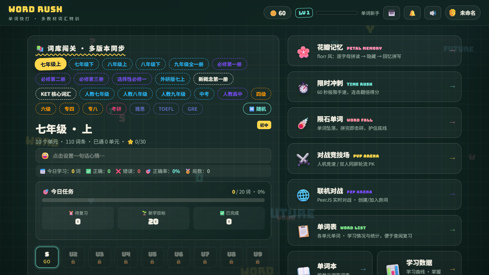
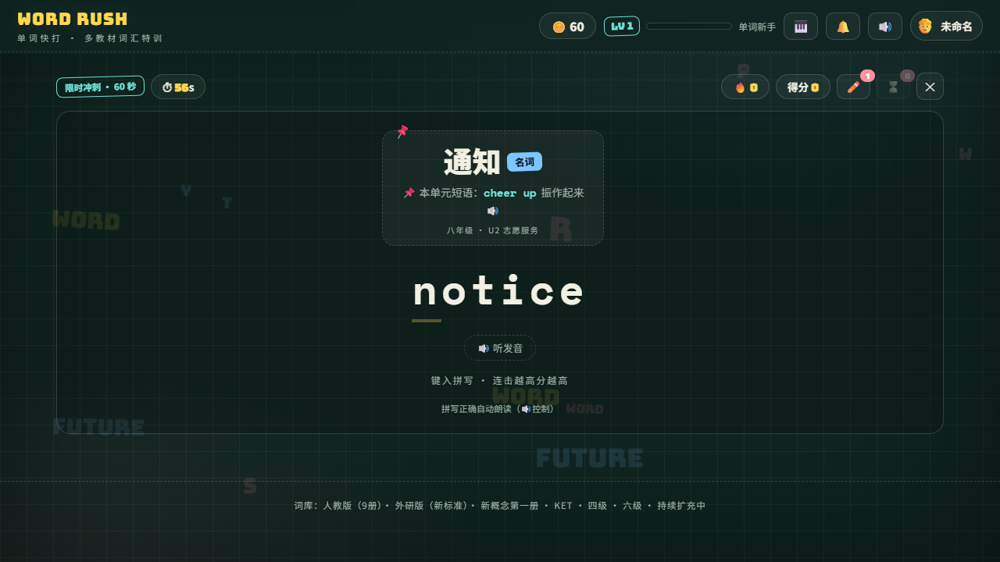

# WORD RUSH 单词快打

多教材 · 多词库的词汇特训打字游戏。纯原生 JS 实现，无框架、无构建工具链，单文件即可发布运行。

## 🌐 在线试玩

### 👉 https://jzice.github.io/word_rush/

由 GitHub Actions 自动构建部署（推送 `master` 或打 `v*` 版本标签即自动更新），无需安装，打开即玩。

## ✨ 功能

- **多教材词库**：人教版（9 册）· 外研版（新标准）· 新概念第一册 · KET · 四级 · 六级
- **五种玩法**：
  - 花瓣记忆（PETAL MEMORY）— 逐字母拼读 → 隐藏 → 回忆拼写
  - 限时冲刺（TIME RUSH）— 60 秒极限手速，连击翻倍得分
  - 陨石单词（WORD FALL）— 单词坠落，拼完击碎，护住底线
  - 对战竞技场（PVP ARENA）— 人机竞速 / 双人同屏轮流 PK
  - 联机对战（P2P ARENA）— 基于 PeerJS 创建/加入房间实时对战
- **记忆系统**：按艾宾浩斯遗忘曲线自动排定复习任务；间隔重复六阶段（陌生→初识→熟悉→掌握→牢固→永久）；错题本集中歼灭拼错的词
- **养成与收集**：等级 / 金币 / 成就墙；奖励商店提供主题皮肤与战斗道具（提示粉笔、时间沙漏、拼写护盾）
- **分享挑战**：生成挑战链接分享给好友

## 📸 截图

| 主页 | 限时冲刺 |
|---|---|
|  |  |

## 🚀 运行（开发模式）

直接加载源文件，无需构建：

```
npm run dev
```

浏览器访问 http://localhost:3000 即可游玩。

## 📦 构建发布

```
npm run build
```

输出单一 HTML 文件 `dist/word_rush.html`（CSS/JS 已内联，双击即玩）。

> 注意：构建产物中的自定义字体（Google Fonts）与联机对战（PeerJS）仍引用外部 CDN，离线环境下这两项不可用。

### ⚙️ 自动发布（GitHub Actions）

仓库内置两个工作流（`.github/workflows/`），推送即触发，无需手动操作：

- `deploy.yml` — 推送 `master` / `main` 分支时，自动构建并部署到 [GitHub Pages](https://jzice.github.io/word_rush/)
- `release.yml` — 推送 `v*` 标签时，自动完成版本发布 + 部署 Pages：

  ```bash
  git tag -a v1.1.0 -m "版本说明"
  git push origin v1.1.0
  ```

  自动执行：构建单文件 → 创建 GitHub Release（自动生成 Release Notes，附带 `word_rush_v1.1.0.html` 单文件附件）→ 部署 Pages。

> 前提：仓库 Settings → Pages 的 Source 选 `GitHub Actions`，且 `github-pages` 环境的 Deployment branches and tags 需包含 `v*` 标签模式（否则标签部署会被环境规则拦截）。

### 📚 添加自定义词库

在 `src/main.js` 顶部的 `DYN_SOURCES` 数组里加一行即可（代码配置，无设置界面）：

```js
{ id: "mybook", name: "我的词库", color: "#5b9bd5", url: "dict/mybook.csv" },
```

`url` 可以是服务器相对路径（如 `dict/mybook.csv`，构建后需与 `dist/word_rush.html` 同目录部署）或任意 http(s) CSV 链接。CSV 格式：`word,phonetic,pos,definition,source`（表头可选），每 50 词自动切一个单元。启动时自动加载并缓存 24 小时；网络失败时先用缓存，缓存也没有就提示一声并跳过该源，其它词书不受影响。

## 🗂 项目结构

- `index.html` — 页面结构，内置 onclick 调用全局函数
- `src/main.js` — 全部游戏逻辑（词库数据、五种模式、存档、商店、成就等）
- `src/style.css` — 全部样式，主题通过 `body[data-theme]` + CSS 变量切换
- `build.mjs` — 构建脚本：把 CSS/JS 内联进 `dist/word_rush.html`
- `dist/` — 构建产物（已 gitignore）

## ⌨️ 操作提示

- 主页：数字键 1-9 快速选择单元；`r` 复习 / `w` 错题 / `m` 花瓣 / `t` 限时 / `f` 陨石 / `b` 对战 / `l` 单词表 / `p` 单词本 / `s` 商店
- 游戏内：直接键入字母即可拼写单词，`Esc` 暂停
- 存档自动保存在浏览器 localStorage（键 `wordrush_v1`）

## 🛠 技术说明

纯 Vanilla JS + CSS；音效用 WebAudio 合成，单词朗读用浏览器 SpeechSynthesis，联机对战用 PeerJS。代码内注释为简体中文。

（暂无自动化测试；改动后用 `npm run build` + 浏览器实测验证。）